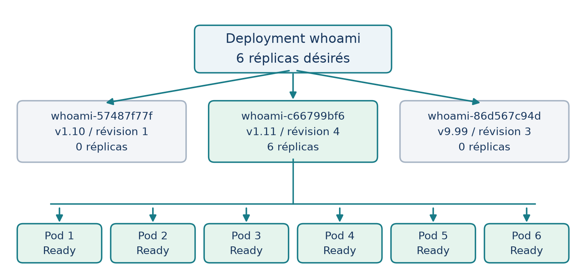
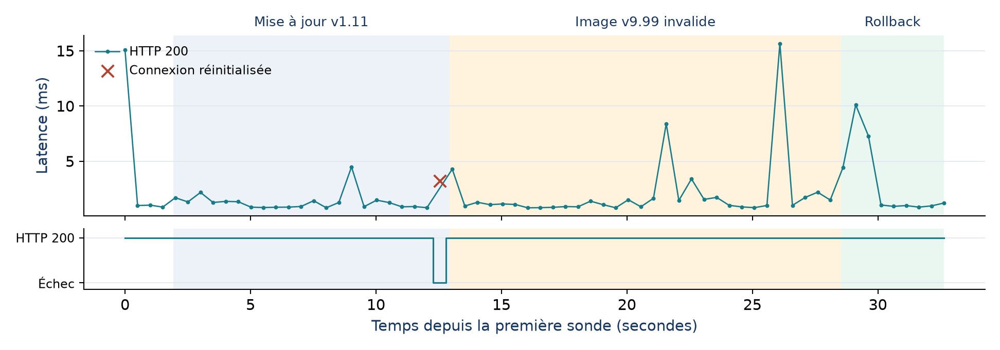
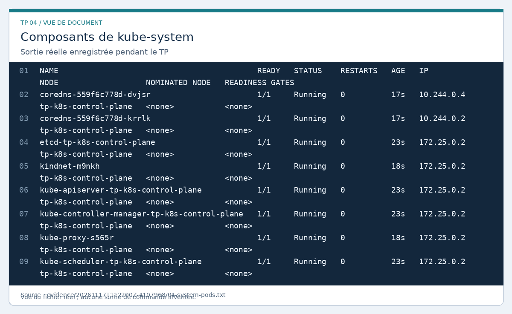
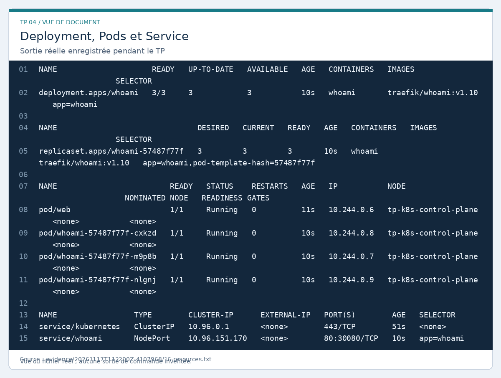
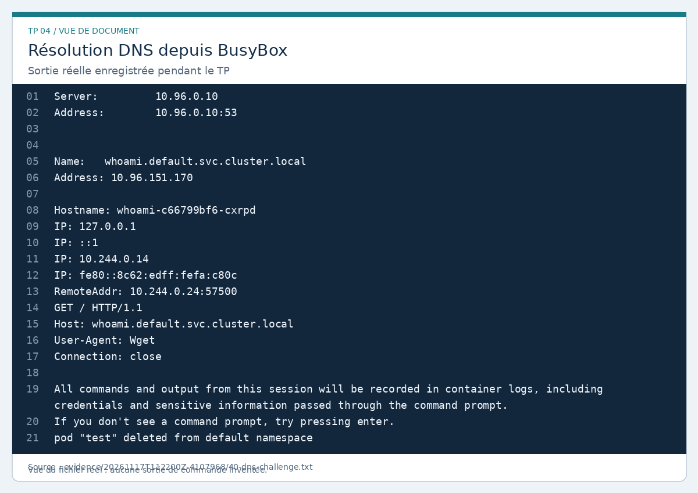
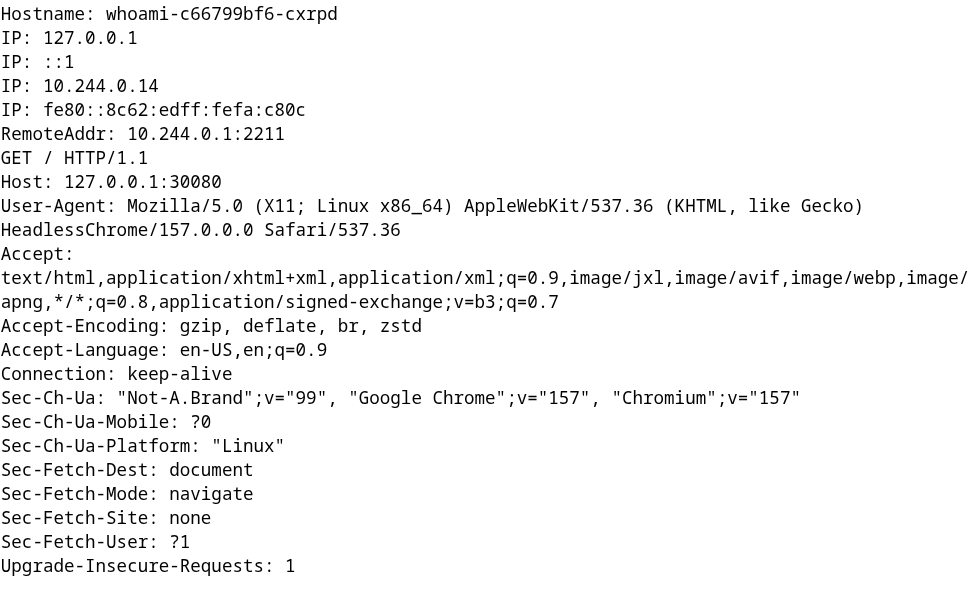

# Rapport de TP 4 : Kubernetes

## 1. Objectifs et état du travail

Les résultats expérimentaux proviennent des preuves collectées pendant le TP.

Le TP porte sur la création d'un cluster Kubernetes local avec kind, la gestion d'un Pod Nginx,
le déploiement de whoami, son exposition par un Service NodePort, la montée en charge et la
gestion d'une mise à jour suivie d'un retour arrière. Le défi final vérifie la résolution DNS interne.

Sujet : TP 4 Kubernetes, GL ENSAH, Université Abdelmalek Essaadi, année universitaire 2026/2027.
Réalisé par : El Abdellaoui Moad. Date de génération : 17/11/2026 11:37.

Le rapport présente les configurations, la démarche et les réponses aux questions du sujet.
Les observations expérimentales sont regroupées dans la section des résultats.

## 2. Environnement et configuration

Le TP est exécuté sous Linux natif avec Docker. Le cluster tp-k8s utilise un nœud nommé
tp-k8s-control-plane, qui héberge le plan de contrôle et les Pods applicatifs. Le fichier
kind-config.yaml décrit cette configuration ; kind-config-multinode.yaml contient la variante
à un control-plane et deux workers du sujet. Le port TCP 30080 du nœud est publié sur
127.0.0.1:30080 de l'hôte.

Docker fournit les conteneurs des nœuds ; kind construit le cluster ; kubectl interroge son API ;
Helm est vérifié comme prérequis, mais aucun chart Helm n'est demandé dans les parties A à D.
Les outils sont installés dans .tools avec vérification SHA-256. Le kubeconfig dédié
reste dans .state et ne doit pas être publié.

Versions exécutées : Docker 29.9.3, kind v0.33.0, Kubernetes v1.37.0 et Helm v4.3.1.
L'image du nœud kind est fixée par digest. La preuve 00-environment.txt conserve les versions complètes.

## 3. Partie A : création du cluster

Le script exécute docker run hello-world puis crée le cluster tp-k8s à partir de kind-config.yaml.
Il attend que le nœud et les Pods de kube-system deviennent Ready avant de continuer.

```bash
kind create cluster --config kind-config.yaml
kubectl get nodes -o wide
kubectl get pods -n kube-system -o wide
docker ps
```

Dans kind, un nœud Kubernetes est un conteneur Docker contenant notamment kubelet et containerd.
Les Pods applicatifs s'exécutent à l'intérieur de ce nœud et ne correspondent pas chacun à un
conteneur visible dans le docker ps de l'hôte.


## 4. Partie B : cycle de vie du Pod

Un Pod autonome web est créé avec nginx:1.27. Les commandes describe, logs et exec permettent
de consulter sa configuration, les requêtes reçues et l'environnement du conteneur. L'ouverture
d'un shell interactif du sujet est automatisée par exec suivi d'un script shell non interactif.

```bash
kubectl run web --image=nginx:1.27 --port=80
kubectl describe pod web
kubectl exec web -- sh -c 'hostname; nginx -v; cat /etc/os-release'
kubectl port-forward pod/web 8080:80
curl http://127.0.0.1:8080
kubectl logs web
kubectl delete pod web
kubectl get pods -l run=web
```

Le script vérifie la page Welcome to nginx avant de supprimer le Pod. Après suppression, il
vérifie que la liste des Pods portant le label run=web est vide. Le Pod est ensuite recréé
avec kubectl apply -f pod.yaml, après génération et capture du manifeste par dry-run.

Le champ restartPolicy: Always concerne le redémarrage des conteneurs d'un Pod existant.
Il ne permet pas de recréer un objet Pod supprimé dans l'API.


## 5. Partie C : Deployment, Service et auto-réparation

whoami.yaml contient un Deployment de trois réplicas et un Service NodePort. Le Deployment
sélectionne les Pods ayant le label app=whoami ; le Service utilise le même sélecteur.
Le port 80 du Service est dirigé vers le port 80 des Pods et exposé sur le NodePort 30080.

```bash
kubectl apply -f whoami.yaml
kubectl get deploy,rs,pods,svc -o wide
kubectl get endpointslices -l kubernetes.io/service-name=whoami -o wide
curl http://127.0.0.1:30080
kubectl delete pod <un-pod-whoami>
kubectl scale deployment whoami --replicas=6
```

Vingt requêtes HTTP permettent de relever les Hostname servis. Plusieurs noms indiquent que
plusieurs Pods ont traité les requêtes ; la répartition n'est pas nécessairement un round-robin strict.
Pour l'auto-réparation, les UID des Pods sont comparés avant et après une suppression : le
script exige trois Pods et au moins un nouvel UID. Après le passage à six réplicas, il exige
six réplicas Ready. Le changement du nombre de réplicas seul ne crée pas de nouveau ReplicaSet.

## 6. Partie D : rolling update, incident et rollback

Une sonde HTTP commence avant la première mise à jour et continue jusqu'après le rollback.
Elle enregistre l'heure UTC, le statut HTTP, le Hostname, la latence et les éventuelles erreurs
dans availability.csv. L'intervalle minimal est de 0,5 seconde, auquel s'ajoute la durée de la requête.

```bash
kubectl set image deployment/whoami whoami=traefik/whoami:v1.11
kubectl rollout status deployment/whoami
kubectl rollout history deployment/whoami
kubectl set image deployment/whoami whoami=traefik/whoami:v9.99
kubectl get pods
kubectl rollout undo deployment/whoami
kubectl rollout status deployment/whoami
kubectl rollout history deployment/whoami
```

Le script attend explicitement ImagePullBackOff, capture l'état du Deployment et teste une
requête HTTP pendant cet incident. Il revient ensuite à l'image précédente, attend la fin du
rollout et vérifie l'image v1.11 ainsi que six réplicas Ready.

Une série de sondes réussies ne prouve pas une absence absolue de microcoupures entre deux
mesures. Un éventuel échec HTTP reste conservé dans les preuves et dans la synthèse.

## 7. Résultats mesurés

Dossier de preuves : evidence/20261117T112200Z-4107968.

État des mesures : parcours complet validé par le script.

Répartition HTTP : 3 Hostname distinct(s) observé(s) : whoami-57487f77f-cxkzd, whoami-57487f77f-m9p8b, whoami-57487f77f-nlgnj.

État final du Deployment : 6 réplicas Ready ; image traefik/whoami:v1.11.

Pendant l'image cassée : 5 réplicas déclarés disponibles par Kubernetes au moment de la capture.

Nombre de ReplicaSets effectivement conservés : 3.

Révisions finales : 1, 3, 4 ; le ReplicaSet v1.11 est actif avec six réplicas.

Sondes HTTP : 66 mesures ; 65 réponses HTTP 200 avec Hostname ; 1 mesure(s) en échec ou sans Hostname.

Pendant l'image invalide : 31/31 sondes HTTP réussies. L'échec isolé survient auparavant, pendant la mise à jour v1.11 (détail à la question 5).

Pod autonome web après suppression : 0 Pod restant avec le label run=web.

Auto-réparation : 3 Pods après suppression et 1 nouvel UID observé ; le Pod supprimé a été remplacé.

Défi DNS : whoami.default.svc.cluster.local est résolu vers 10.96.151.170 ; la requête wget depuis BusyBox reçoit une réponse whoami.

## 8. Réponses aux questions

### Question 1 : rôle des composants de kube-system

- etcd conserve de manière persistante l'état du cluster et les objets de l'API.
- kube-apiserver expose l'API, authentifie et autorise les requêtes, puis valide les objets et échange avec etcd.
- kube-scheduler choisit un nœud pour chaque Pod non affecté selon ses besoins et les contraintes du cluster.
- kube-controller-manager exécute les boucles de contrôle qui rapprochent l'état observé de l'état désiré, notamment pour les Deployments et ReplicaSets.
- kube-proxy programme les règles réseau nécessaires aux Services et à la distribution vers leurs endpoints.
- CoreDNS résout les noms internes des Services et transmet les requêtes externes aux résolveurs configurés.
- kindnet assure le réseau des Pods dans kind : configuration CNI, routes entre nœuds et règles de masquage.

### Question 2 : pourquoi le Pod web ne revient-il pas ?

web est un Pod autonome, sans contrôleur propriétaire chargé de maintenir son existence.
Sa suppression retire l'objet désiré lui-même. À l'inverse, un ReplicaSet conserve un nombre
de réplicas demandé et crée un Pod de remplacement lorsque le nombre observé devient insuffisant.
Le nouveau Pod possède un nouvel UID, et généralement un nouveau nom et une nouvelle adresse IP.

### Question 3 : Deployment, ReplicaSet et Pod

Le Deployment décrit la version souhaitée du modèle de Pod et pilote les transitions entre
ReplicaSets. Chaque ReplicaSet maintient le nombre de Pods correspondant à son modèle.
Les Pods exécutent les conteneurs. La relation de propriété est donc Deployment -> ReplicaSet -> Pod.

À la fin du parcours, trois ReplicaSets sont conservés : un pour v1.10, un pour v1.11
et un pour v9.99. Le passage de trois à six réplicas ne modifie pas le modèle de Pod et ne crée
pas de ReplicaSet. Le rollback réutilise le ReplicaSet de v1.11 et met à jour sa révision ; il
ne nécessite pas un quatrième modèle. Les anciens ReplicaSets restent à zéro pour l'historique,
sous réserve de revisionHistoryLimit. Les révisions observées sont 1, 3 et 4 : le rollback a
réaffecté la révision 4 au ReplicaSet de v1.11, précédemment en révision 2.



### Question 4 : comment le Service trouve-t-il ses Pods ?

Le sélecteur app=whoami sélectionne les Pods du même namespace possédant ce label. Le
contrôleur EndpointSlice maintient les adresses IP, ports et conditions des endpoints
correspondants. kube-proxy exploite ces informations pour les règles réseau du Service.
Un endpoint non prêt est normalement exclu du trafic. L'adresse du Service reste stable
alors que les Pods et leurs adresses peuvent changer.

### Question 5 : disponibilité pendant l'image cassée

RollingUpdate utilise maxUnavailable=25 % et maxSurge=25 %. Pour six réplicas, cela donne
un Pod indisponible au maximum (arrondi inférieur) et deux Pods supplémentaires (arrondi supérieur).
Le contrôleur cherche ainsi à conserver cinq réplicas disponibles, avec au plus huit réplicas
désirés pendant la transition, hors Pods en terminaison.

Les Pods utilisant v9.99 ne deviennent pas disponibles. Le contrôleur conserve les anciens
Pods sains et le rollout bloque. Le manifeste du sujet ne comporte pas de readinessProbe
applicative : les sondes HTTP complètent donc les conditions Ready observées par Kubernetes.

Pendant l'image v9.99 : 5 réplicas disponibles et 31/31 sondes HTTP 200. Sur l'ensemble de la mesure : 65/66 requêtes réussies. Un échec est relevé à 11:24:14 UTC : [Errno 104] Connection reset by peer. Il survient pendant la mise à jour v1.11, avant l'image invalide ; les requêtes adjacentes réussissent. La mise à jour comporte donc un échec de connexion isolé, tandis que l'accès reste fonctionnel pendant l'image cassée.



## 9. Défi DNS

Un Pod temporaire BusyBox effectue une résolution DNS puis une requête HTTP depuis le réseau
interne du cluster. Le script remplace le shell interactif par la même vérification automatisée.

```bash
kubectl run test --rm -i --restart=Never --image=busybox:1.36 --   sh -c 'nslookup whoami.default.svc.cluster.local && wget -qO- http://whoami.default.svc.cluster.local'
```

- whoami : nom du Service.
- default : namespace contenant le Service.
- svc : domaine réservé aux Services Kubernetes.
- cluster.local : domaine DNS du cluster dans cette installation kind.

Pour ce Service NodePort, le nom DNS interne désigne son adresse ClusterIP. La requête HTTP
utilise le port 80 du Service ; le port 30080 sert à l'accès depuis l'hôte. Le suffixe cluster.local
n'est normalement pas résolu par le DNS de l'hôte en dehors du cluster.

## 10. Reproduction, dépôt et nettoyage

Depuis la racine du dossier, exécuter sur la machine hôte :

```bash
sudo bash scripts/run-tp4.sh
```

Le script démarre Docker si nécessaire, installe les outils manquants dans .tools, conserve
un kubeconfig isolé et produit les preuves horodatées. Il n'efface aucun cluster préexistant
non identifié comme créé par lui. Une reprise du même script réinitialise uniquement les objets
de ce TP dans son cluster dédié. Le cluster reste disponible après le TP pour inspection.

Dépôt de remise : k8s-tp-el-abdellaoui-moad. La publication est effectuée avec scripts/publish-tp4.sh après validation des résultats.

Le dépôt contient les YAML, scripts, README, rapport, captures et preuves textuelles.
Les dossiers .state, .tools et les kubeconfigs restent exclus de la remise.

Après consultation des résultats, le cluster peut être supprimé explicitement :

```bash
sudo .tools/kind delete cluster --name tp-k8s
```

Cette commande supprime les nœuds du TP et leur état. Elle ne supprime pas les preuves, les
rapports ni les images Docker téléchargées. Aucune purge globale Docker n'est exécutée.

## 11. Références

- Sujet fourni : TP 4 Kubernetes.pdf.
- Guide officiel kind : https://kind.sigs.k8s.io/docs/user/quick-start/
- Versions et digest kind : https://github.com/kubernetes-sigs/kind/releases/tag/v0.33.0
- Architecture Kubernetes : https://kubernetes.io/docs/concepts/architecture/
- Deployments et stratégie RollingUpdate : https://kubernetes.io/docs/concepts/workloads/controllers/deployment/
- EndpointSlices : https://kubernetes.io/docs/concepts/services-networking/endpoint-slices/
- DNS interne : https://kubernetes.io/docs/concepts/services-networking/dns-pod-service/
- Installation de kubectl : https://kubernetes.io/docs/tasks/tools/install-kubectl-linux/
- Installation de Helm : https://helm.sh/docs/intro/install/

## Annexe A : configuration du cluster


## Annexe B : manifeste du Pod

```yaml
apiVersion: v1
kind: Pod
metadata:
  name: web
  labels:
    run: web
spec:
  containers:
    - name: web
      image: nginx:1.27
      ports:
        - containerPort: 80
  restartPolicy: Always
```

## Annexe C : Deployment et Service


## Annexe D : environnement

```text
2026-11-17T11:22:06+00:00
Linux 7.3.1-1-cachyos x86_64 GNU/Linux
               total        used        free      shared  buff/cache   available
Mem:           7.5Gi       5.0Gi       971Mi       286Mi       2.1Gi       2.5Gi
Swap:           14Gi       6.4Gi       8.5Gi
Filesystem      Size  Used Avail Use% Mounted on
/dev/nvme0n1p1  236G  207G   27G  89% /home
Client:
 Version:           29.9.3
 API version:       1.56
 Go version:        go1.27.3-X:nodwarf5
 Git commit:        5457199aa5
 Built:             Thu Nov  5 15:25:16 2026
 OS/Arch:           linux/amd64
 Context:           default

Server:
 Engine:
  Version:          29.9.3
  API version:      1.56 (minimum version 1.40)
  Go version:       go1.27.3-X:nodwarf5
  Git commit:       70efc0e31d
  Built:            Thu Nov  5 15:25:16 2026
  OS/Arch:          linux/amd64
  Experimental:     false
 containerd:
  Version:          v2.4.2
  GitCommit:        b7a25261e029d68978bbf290df0a62fc819b3c51.m
 runc:
  Version:          1.5.2
  GitCommit:        1.5.2-1-0-g17cc947-dirty
 docker-init:
  Version:          0.19.0
  GitCommit:        de40ad0
kind v0.33.0 go1.26.7 linux/amd64
Client Version: v1.37.0
Kustomize Version: v5.8.1
version.BuildInfo{Version:"v4.3.1", GitCommit:"c0d08d0d6d9424d4a14febb5e8a3e51b0dd00dff", GitTreeState:"clean", GoVersion:"go1.27.2", KubeClientVersion:"v1.37"}
```

## Annexe E : nœuds et composants système


## Annexe F : Pods système



## Annexe G : ressources avant les mises à jour



## Annexe H : image invalide


## Annexe I : historique réel des rollouts


## Annexe J : ReplicaSets finaux

```text
NAME                DESIRED   CURRENT   READY   AGE   CONTAINERS   IMAGES                 SELECTOR
whoami-57487f77f    0         0         0       50s   whoami       traefik/whoami:v1.10   app=whoami,pod-template-hash=57487f77f
whoami-86d567c94d   0         0         0       20s   whoami       traefik/whoami:v9.99   app=whoami,pod-template-hash=86d567c94d
whoami-c66799bf6    6         6         6       31s   whoami       traefik/whoami:v1.11   app=whoami,pod-template-hash=c66799bf6
```

## Annexe K : résolution DNS et réponse HTTP



## Annexe L : EndpointSlices finaux

```text
NAME           ADDRESSTYPE   PORTS   ENDPOINTS                                         AGE
whoami-llmsp   IPv4          80      10.244.0.15,10.244.0.17,10.244.0.14 + 3 more...   58s
```

## Annexe M : accès HTTP après rollback


