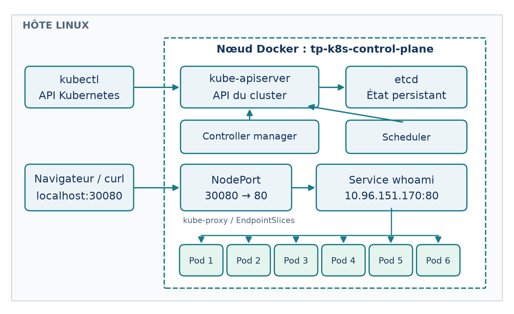
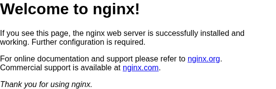
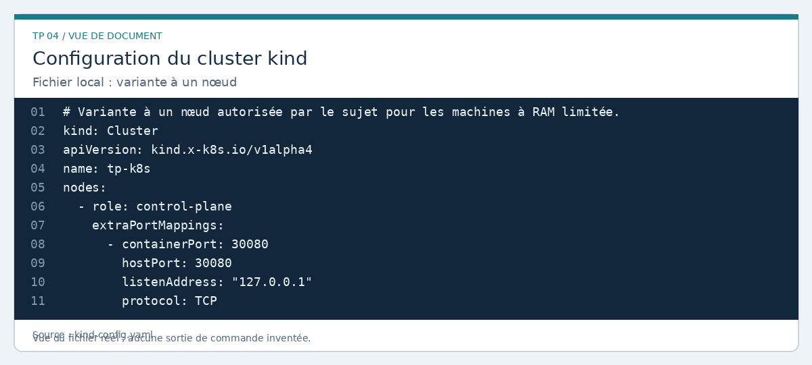
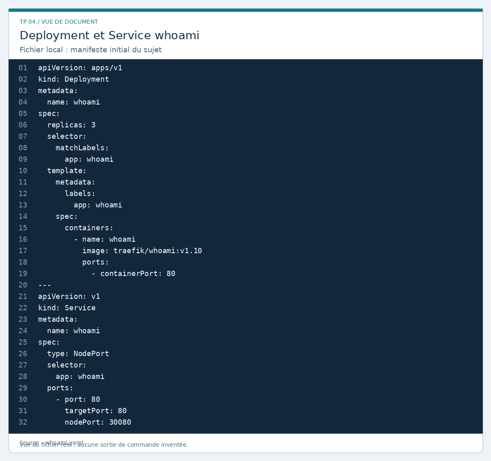
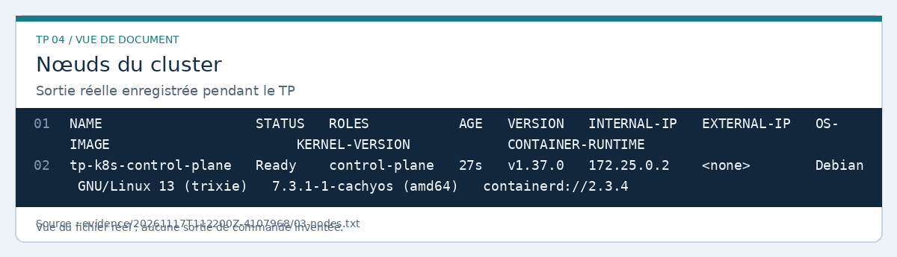
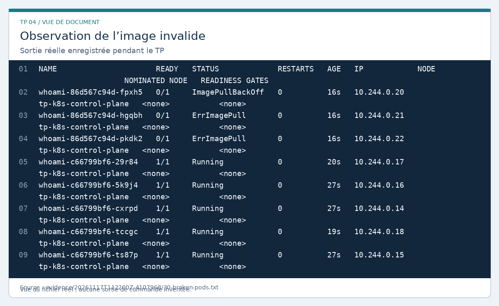
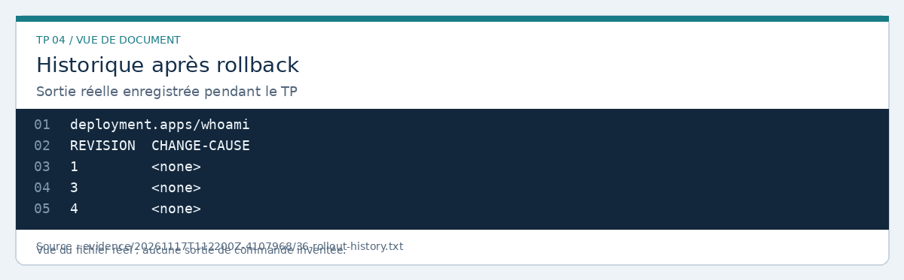

# Rapport de TP 4 : Kubernetes

## 1. Objectifs et état du travail

Les résultats expérimentaux proviennent des preuves collectées pendant le TP.

Le TP porte sur la création d'un cluster Kubernetes local avec kind, la gestion d'un Pod Nginx,
le déploiement de whoami, son exposition par un Service NodePort, la montée en charge et la
gestion d'une mise à jour suivie d'un retour arrière. Le défi final vérifie la résolution DNS interne.

Sujet : TP 4 Kubernetes, GL ENSAH, Université Abdelmalek Essaadi, année universitaire 2026/2027.
Réalisé par : El Abdellaoui Moad. Date de génération : 17/11/2026 11:50.

Le rapport présente les configurations, la démarche et les réponses aux questions du sujet.
Les observations expérimentales sont regroupées dans la section des résultats.

## 2. Environnement et configuration

Le TP est exécuté sous Linux natif avec Docker. Le cluster tp-k8s utilise un nœud nommé
tp-k8s-control-plane, qui héberge le plan de contrôle et les Pods applicatifs. Le fichier
kind-config.yaml décrit cette configuration ; kind-config-multinode.yaml contient la variante
à un control-plane et deux workers du sujet. Le port TCP 30080 du nœud est publié sur
127.0.0.1:30080 de l'hôte.

Docker fournit les conteneurs des nœuds ; kind construit le cluster ; kubectl interroge son API ;
Helm est vérifié comme prérequis, mais aucun chart Helm n'est demandé dans les parties A à D.
Les outils sont installés dans .tools avec vérification SHA-256. Le kubeconfig dédié
reste dans .state et ne doit pas être publié.

Versions exécutées : Docker 29.9.3, kind v0.33.0, Kubernetes v1.37.0 et Helm v4.3.1.
L'image du nœud kind est fixée par digest. La preuve 00-environment.txt conserve les versions complètes.


<!-- command:start -->
```text
$ docker run --rm hello-world
Hello from Docker!
This message shows that your installation appears to be working correctly.

To generate this message, Docker took the following steps:
 1. The Docker client contacted the Docker daemon.
 2. The Docker daemon pulled the "hello-world" image from the Docker Hub.
    (amd64)
 3. The Docker daemon created a new container from that image which runs the
    executable that produces the output you are currently reading.
 4. The Docker daemon streamed that output to the Docker client, which sent it
    to your terminal.

To try something more ambitious, you can run an Ubuntu container with:
 $ docker run -it ubuntu bash

Share images, automate workflows, and more with a free Docker ID:
 https://hub.docker.com/

For more examples and ideas, visit:
 https://docs.docker.com/get-started/
```

Interprétation : Hello from Docker! confirme que le client a joint le démon, lancé le conteneur de test et récupéré sa sortie.

Source : 01-hello-world.txt.
<!-- command:end -->

<!-- command:start -->
```text
$ kind version
kind v0.33.0 go1.26.7 linux/amd64
```

Interprétation : kind v0.33.0 est installé et exécutable sur Linux amd64.

Source : 00-environment.txt.
<!-- command:end -->

<!-- command:start -->
```text
$ kubectl version --client
Client Version: v1.37.0
Kustomize Version: v5.8.1
```

Interprétation : Le client kubectl v1.37.0 est installé. Kustomize est l’outil de personnalisation des manifests intégré au client.

Source : 00-environment.txt.
<!-- command:end -->

<!-- command:start -->
```text
$ helm version
version.BuildInfo{Version:"v4.3.1", GitCommit:"c0d08d0d6d9424d4a14febb5e8a3e51b0dd00dff", GitTreeState:"clean", GoVersion:"go1.27.2", KubeClientVersion:"v1.37"}
```

Interprétation : Helm v4.3.1 est disponible. Le TP vérifie ce prérequis, mais les exercices A à D ne déploient aucun chart Helm.

Source : 00-environment.txt.
<!-- command:end -->

## 3. Partie A : création du cluster

Le script exécute docker run hello-world puis crée le cluster tp-k8s à partir de kind-config.yaml.
Il attend que le nœud et les Pods de kube-system deviennent Ready avant de continuer.

<!-- command:start -->
```text
$ kind create cluster --config kind-config.yaml --wait 300s
using docker due to KIND_EXPERIMENTAL_PROVIDER
Creating cluster "tp-k8s" ...
 - Ensuring node image (kindest/node:v1.37.0)   ...
 [OK] Ensuring node image (kindest/node:v1.37.0) 
 - Preparing nodes    ...
 [OK] Preparing nodes  
 - Writing configuration   ...
 [OK] Writing configuration 
 - Starting control-plane   ...
 [OK] Starting control-plane 
 - Installing CNI   ...
 [OK] Installing CNI 
 - Installing StorageClass   ...
 [OK] Installing StorageClass 
 - Waiting <= 5m0s for control-plane = Ready   ...
 [OK] Waiting <= 5m0s for control-plane = Ready 
 - Ready after 16s 
Set kubectl context to "kind-tp-k8s"
You can now use your cluster with:

kubectl cluster-info --context kind-tp-k8s --kubeconfig /home/moadabdou/coding/projects/cloud/tp4/.state/kubeconfig

Not sure what to do next?   Check out https://kind.sigs.k8s.io/docs/user/quick-start/
```

Interprétation : kind a créé le nœud, démarré le plan de contrôle, installé le réseau CNI et attendu Ready. Le message Ready after 16s confirme cette dernière attente ; il ne comprend pas tout le temps de téléchargement de l’image.

Source : 02-create-cluster.txt.
<!-- command:end -->

<!-- command:start -->
```text
$ kubectl get nodes -o wide
NAME                   STATUS   ROLES           AGE   VERSION   INTERNAL-IP   EXTERNAL-IP   OS-IMAGE                       KERNEL-VERSION            CONTAINER-RUNTIME
tp-k8s-control-plane   Ready    control-plane   27s   v1.37.0   172.25.0.2    <none>        Debian GNU/Linux 13 (trixie)   7.3.1-1-cachyos (amd64)   containerd://2.3.4
```

Interprétation : Le nœud tp-k8s-control-plane est Ready sous Kubernetes v1.37.0. Son adresse interne est 172.25.0.2 et son runtime est containerd. Le cluster est donc joignable et prêt à accueillir des Pods.

Source : 03-nodes.txt.
<!-- command:end -->

<!-- command:start -->
```text
$ kubectl get pods -n kube-system -o wide
NAME                                           READY   STATUS    RESTARTS   AGE   IP           NODE                   NOMINATED NODE   READINESS GATES
coredns-559f6c778d-dvjsr                       1/1     Running   0          17s   10.244.0.4   tp-k8s-control-plane   <none>           <none>
coredns-559f6c778d-krrlk                       1/1     Running   0          17s   10.244.0.2   tp-k8s-control-plane   <none>           <none>
etcd-tp-k8s-control-plane                      1/1     Running   0          23s   172.25.0.2   tp-k8s-control-plane   <none>           <none>
kindnet-m9nkh                                  1/1     Running   0          18s   172.25.0.2   tp-k8s-control-plane   <none>           <none>
kube-apiserver-tp-k8s-control-plane            1/1     Running   0          23s   172.25.0.2   tp-k8s-control-plane   <none>           <none>
kube-controller-manager-tp-k8s-control-plane   1/1     Running   0          23s   172.25.0.2   tp-k8s-control-plane   <none>           <none>
kube-proxy-s565r                               1/1     Running   0          18s   172.25.0.2   tp-k8s-control-plane   <none>           <none>
kube-scheduler-tp-k8s-control-plane            1/1     Running   0          23s   172.25.0.2   tp-k8s-control-plane   <none>           <none>
```

Interprétation : Les huit Pods système sont Running avec 1/1 conteneur prêt et aucun redémarrage. On retrouve notamment etcd, les composants du plan de contrôle, kube-proxy, kindnet et deux réplicas CoreDNS.

Source : 04-system-pods.txt.
<!-- command:end -->

<!-- command:start -->
```text
$ docker ps --filter label=io.x-k8s.kind.cluster=tp-k8s
CONTAINER ID   IMAGE                  COMMAND                  CREATED          STATUS          PORTS                                                   NAMES
5503c2c301be   kindest/node:v1.37.0   "/usr/local/bin/entr…"   53 seconds ago   Up 49 seconds   127.0.0.1:30080->30080/tcp, 127.0.0.1:43925->6443/tcp   tp-k8s-control-plane
```

Interprétation : Un conteneur Docker représente le nœud kind. Le port 30080 du nœud est publié sur 127.0.0.1:30080 ; le port 6443 de l’API est publié sur le port local 43925.

Source : 05-docker-nodes.txt.
<!-- command:end -->

Dans kind, un nœud Kubernetes est un conteneur Docker contenant notamment kubelet et containerd.
Les Pods applicatifs s'exécutent à l'intérieur de ce nœud et ne correspondent pas chacun à un
conteneur visible dans le docker ps de l'hôte.




## 4. Partie B : cycle de vie du Pod

Un Pod autonome web est créé avec nginx:1.27. Les commandes describe, logs et exec permettent
de consulter sa configuration, les requêtes reçues et l'environnement du conteneur. L'ouverture
d'un shell interactif du sujet est automatisée par exec suivi d'un script shell non interactif.

<!-- command:start -->
```text
$ kubectl run web --image=nginx:1.27 --port=80
pod/web created
```

Interprétation : pod/web created confirme la création de l’objet Pod autonome. Ce message ne suffit pas à prouver que Nginx est prêt ; la vérification suivante montre son état.

Source : 06-run-web.txt.
<!-- command:end -->

<!-- command:start -->
Extrait des 24 premières lignes ; la sortie intégrale est conservée dans 07-web-describe.txt.

```text
$ kubectl describe pod web
Name:             web
Namespace:        default
Priority:         0
Service Account:  default
Node:             tp-k8s-control-plane/172.25.0.2
Start Time:       Tue, 17 Nov 2026 11:23:29 +0000
Labels:           run=web
Annotations:      <none>
Status:           Running
IP:               10.244.0.5
IPs:
  IP:  10.244.0.5
Containers:
  web:
    Container ID:   containerd://56c7a1730d4d781461fa31f3636172d5e8853b1eae9066a8496b521f11d3cf41
    Image:          nginx:1.27
    Image ID:       docker.io/library/nginx@sha256:6784fb0834aa7dbbe12e3d7471e69c290df3e6ba810dc38b34ae33d3c1c05f7d
    Port:           80/TCP
    Host Port:      0/TCP
    State:          Running
      Started:      Tue, 17 Nov 2026 11:23:37 +0000
    Ready:          True
    Restart Count:  0
    Environment:    <none>
```

Interprétation : Le Pod est Running sur tp-k8s-control-plane, avec l’adresse 10.244.0.5. Le conteneur utilise nginx:1.27, est Ready et n’a pas redémarré. Le port 80 est déclaré dans sa configuration.

Source : 07-web-describe.txt.
<!-- command:end -->

<!-- command:start -->
```text
$ kubectl exec web -- sh -c 'hostname; nginx -v; cat /etc/os-release'
web
nginx version: nginx/1.27.5
PRETTY_NAME="Debian GNU/Linux 12 (bookworm)"
NAME="Debian GNU/Linux"
VERSION_ID="12"
VERSION="12 (bookworm)"
VERSION_CODENAME=bookworm
ID=debian
HOME_URL="https://www.debian.org/"
SUPPORT_URL="https://www.debian.org/support"
BUG_REPORT_URL="https://bugs.debian.org/"
```

Interprétation : Le nom web confirme que la commande s’exécute dans le Pod. L’image nginx:1.27 contient ici Nginx 1.27.5 sur Debian 12 ; le système du conteneur est distinct du Linux de l’hôte.

Source : 08-web-shell.txt.
<!-- command:end -->

<!-- command:start -->
```text
$ kubectl port-forward pod/web 8080:80
Forwarding from 127.0.0.1:8080 -> 80
Forwarding from [::1]:8080 -> 80
Handling connection for 8080
```

Interprétation : kubectl écoute sur les adresses locales IPv4 et IPv6, puis transfère les connexions au port 80 du Pod. Handling connection signale qu’une requête a traversé ce tunnel.

Source : 09-port-forward.txt.
<!-- command:end -->

<!-- command:start -->
```text
$ curl http://127.0.0.1:8080
<!DOCTYPE html>
<html>
<head>
<title>Welcome to nginx!</title>
<style>
html { color-scheme: light dark; }
body { width: 35em; margin: 0 auto;
font-family: Tahoma, Verdana, Arial, sans-serif; }
</style>
</head>
<body>
<h1>Welcome to nginx!</h1>
<p>If you see this page, the nginx web server is successfully installed and
working. Further configuration is required.</p>

<p>For online documentation and support please refer to
<a href="http://nginx.org/">nginx.org</a>.<br/>
Commercial support is available at
<a href="http://nginx.com/">nginx.com</a>.</p>

<p><em>Thank you for using nginx.</em></p>
</body>
</html>
```

Interprétation : Le HTML retourné contient le titre Welcome to nginx!. Le test HTTP a atteint Nginx via le port-forward ; le port 8080 n’est pas un Service Kubernetes.

Source : 10-nginx.html.
<!-- command:end -->

<!-- command:start -->
```text
$ kubectl logs web
/docker-entrypoint.sh: /docker-entrypoint.d/ is not empty, will attempt to perform configuration
/docker-entrypoint.sh: Looking for shell scripts in /docker-entrypoint.d/
/docker-entrypoint.sh: Launching /docker-entrypoint.d/10-listen-on-ipv6-by-default.sh
10-listen-on-ipv6-by-default.sh: info: Getting the checksum of /etc/nginx/conf.d/default.conf
10-listen-on-ipv6-by-default.sh: info: Enabled listen on IPv6 in /etc/nginx/conf.d/default.conf
/docker-entrypoint.sh: Sourcing /docker-entrypoint.d/15-local-resolvers.envsh
/docker-entrypoint.sh: Launching /docker-entrypoint.d/20-envsubst-on-templates.sh
/docker-entrypoint.sh: Launching /docker-entrypoint.d/30-tune-worker-processes.sh
/docker-entrypoint.sh: Configuration complete; ready for start up
2026/11/17 11:23:38 [notice] 1#1: using the "epoll" event method
2026/11/17 11:23:38 [notice] 1#1: nginx/1.27.5
2026/11/17 11:23:38 [notice] 1#1: built by gcc 12.2.0 (Debian 12.2.0-14) 
2026/11/17 11:23:38 [notice] 1#1: OS: Linux 7.3.1-1-cachyos
2026/11/17 11:23:38 [notice] 1#1: getrlimit(RLIMIT_NOFILE): 2147483584:2147483584
2026/11/17 11:23:38 [notice] 1#1: start worker processes
2026/11/17 11:23:38 [notice] 1#1: start worker process 35
2026/11/17 11:23:38 [notice] 1#1: start worker process 36
2026/11/17 11:23:38 [notice] 1#1: start worker process 37
2026/11/17 11:23:38 [notice] 1#1: start worker process 38
2026/11/17 11:23:38 [notice] 1#1: start worker process 39
2026/11/17 11:23:38 [notice] 1#1: start worker process 40
2026/11/17 11:23:38 [notice] 1#1: start worker process 41
2026/11/17 11:23:38 [notice] 1#1: start worker process 42
```

<!-- command:end -->

<!-- command:start -->
Sortie de la même commande (suite).

```text
127.0.0.1 - - [17/Nov/2026:11:23:39 +0000] "GET / HTTP/1.1" 200 615 "-" "curl/8.23.0" "-"
```

Interprétation : Nginx a terminé son initialisation et démarré ses workers. La dernière ligne enregistre GET / avec le statut 200 et 615 octets : elle confirme la requête HTTP réussie du test précédent.

Source : 11-web-logs.txt.
<!-- command:end -->

<!-- command:start -->
```text
$ kubectl delete pod web
pod "web" deleted from default namespace
```

Interprétation : La suppression est confirmée par kubectl. Comme aucun ReplicaSet ne possède ce Pod, aucun contrôleur n’est chargé de le recréer automatiquement.

Source : session.txt.
<!-- command:end -->

<!-- command:start -->
```text
$ kubectl get pods -l run=web -o json
{
    "apiVersion": "v1",
    "items": [],
    "kind": "List",
    "metadata": {
        "resourceVersion": ""
    }
}
```

Interprétation : Le tableau items est vide après la suppression : il n’existe plus de Pod portant le label run=web. C’est la preuve que le Pod autonome n’a pas été recréé.

Source : 12-standalone-deleted.json.
<!-- command:end -->

<!-- command:start -->
```text
$ kubectl run web --image=nginx:1.27 --dry-run=client -o yaml
apiVersion: v1
kind: Pod
metadata:
  labels:
    run: web
  name: web
  namespace: default
spec:
  containers:
  - image: nginx:1.27
    name: web
    resources: {}
  dnsPolicy: ClusterFirst
  restartPolicy: Always
status: {}
```

Interprétation : Le dry-run produit un manifeste YAML sans créer de Pod. Il expose les champs apiVersion, kind, metadata et spec ; restartPolicy concerne les conteneurs du Pod, pas la recréation d’un objet supprimé.

Source : 13-generated-pod.yaml.
<!-- command:end -->

<!-- command:start -->
```text
$ kubectl apply -f pod.yaml
pod/web created
```

Interprétation : Le manifeste déclaratif crée un nouveau Pod web. Le script attend ensuite sa condition Ready avant de poursuivre. Réappliquer ce même manifeste permet de maintenir la configuration déclarée.

Source : 14-declarative-pod.txt.
<!-- command:end -->

Le script vérifie la page Welcome to nginx avant de supprimer le Pod. Après suppression, il
vérifie que la liste des Pods portant le label run=web est vide. Le Pod est ensuite recréé
avec kubectl apply -f pod.yaml, après génération et capture du manifeste par dry-run.

Le champ restartPolicy: Always concerne le redémarrage des conteneurs d'un Pod existant.
Il ne permet pas de recréer un objet Pod supprimé dans l'API.




## 5. Partie C : Deployment, Service et auto-réparation

whoami.yaml contient un Deployment de trois réplicas et un Service NodePort. Le Deployment
sélectionne les Pods ayant le label app=whoami ; le Service utilise le même sélecteur.
Le port 80 du Service est dirigé vers le port 80 des Pods et exposé sur le NodePort 30080.

<!-- command:start -->
```text
$ kubectl apply -f whoami.yaml
deployment.apps/whoami created
service/whoami created
```

Interprétation : Deux objets sont créés : le Deployment whoami et le Service whoami. Le premier pilote trois réplicas ; le second expose leurs ports HTTP.

Source : 15-deployment.txt.
<!-- command:end -->

<!-- command:start -->
```text
$ kubectl get deploy,rs,pods,svc -o wide
NAME                     READY   UP-TO-DATE   AVAILABLE   AGE   CONTAINERS   IMAGES                 SELECTOR
deployment.apps/whoami   3/3     3            3           10s   whoami       traefik/whoami:v1.10   app=whoami

NAME                               DESIRED   CURRENT   READY   AGE   CONTAINERS   IMAGES                 SELECTOR
replicaset.apps/whoami-57487f77f   3         3         3       10s   whoami       traefik/whoami:v1.10   app=whoami,pod-template-hash=57487f77f

NAME                         READY   STATUS    RESTARTS   AGE   IP           NODE                   NOMINATED NODE   READINESS GATES
pod/web                      1/1     Running   0          11s   10.244.0.6   tp-k8s-control-plane   <none>           <none>
pod/whoami-57487f77f-cxkzd   1/1     Running   0          10s   10.244.0.8   tp-k8s-control-plane   <none>           <none>
pod/whoami-57487f77f-m9p8b   1/1     Running   0          10s   10.244.0.7   tp-k8s-control-plane   <none>           <none>
pod/whoami-57487f77f-nlgnj   1/1     Running   0          10s   10.244.0.9   tp-k8s-control-plane   <none>           <none>

NAME                 TYPE        CLUSTER-IP      EXTERNAL-IP   PORT(S)        AGE   SELECTOR
service/kubernetes   ClusterIP   10.96.0.1       <none>        443/TCP        51s   <none>
service/whoami       NodePort    10.96.151.170   <none>        80:30080/TCP   10s   app=whoami
```

Interprétation : Le Deployment est à 3/3, son ReplicaSet possède trois Pods Ready et le Service est de type NodePort. L’adresse ClusterIP est 10.96.151.170 ; 80:30080/TCP relie le port du Service au NodePort accessible depuis l’hôte.

Source : 16-resources.txt.
<!-- command:end -->

<!-- command:start -->
```text
$ kubectl get endpointslices -l kubernetes.io/service-name=whoami -o wide
NAME           ADDRESSTYPE   PORTS   ENDPOINTS                          AGE
whoami-llmsp   IPv4          80      10.244.0.7,10.244.0.8,10.244.0.9   10s
```

Interprétation : L’EndpointSlice référence les trois adresses 10.244.0.7, 10.244.0.8 et 10.244.0.9 sur le port 80. Ce sont les destinations sélectionnées par le Service avec le label app=whoami.

Source : 17-endpointslices.txt.
<!-- command:end -->

<!-- command:start -->
```text
$ curl http://127.0.0.1:30080
Hostname: whoami-57487f77f-m9p8b
IP: 127.0.0.1
IP: ::1
IP: 10.244.0.7
IP: fe80::ac7e:c6ff:fe5f:f237
RemoteAddr: 10.244.0.1:12530
GET / HTTP/1.1
Host: 127.0.0.1:30080
User-Agent: curl/8.23.0
Accept: */*

Hostname: whoami-57487f77f-m9p8b
IP: 127.0.0.1
IP: ::1
IP: 10.244.0.7
IP: fe80::ac7e:c6ff:fe5f:f237
RemoteAddr: 10.244.0.1:15106
GET / HTTP/1.1
Host: 127.0.0.1:30080
User-Agent: curl/8.23.0
Accept: */*

Hostname: whoami-57487f77f-nlgnj
IP: 127.0.0.1
IP: ::1
IP: 10.244.0.9
IP: fe80::4cf9:20ff:fe53:4427
```

<!-- command:end -->

<!-- command:start -->
Sortie de la même commande (suite).

```text
RemoteAddr: 10.244.0.1:25427
GET / HTTP/1.1
Host: 127.0.0.1:30080
User-Agent: curl/8.23.0
Accept: */*
```

Interprétation : Chaque réponse identifie le Pod qui l’a traitée par Hostname. Sur les vingt requêtes enregistrées, les trois noms de Pods apparaissent : le Service distribue donc effectivement les connexions entre les trois réplicas. La sortie ci-dessus montre les trois premières réponses ; les vingt réponses figurent dans la trace complète.

Source : 18-load-balancing.txt.
<!-- command:end -->

<!-- command:start -->
```text
$ kubectl delete pod whoami-57487f77f-cxkzd
pod "whoami-57487f77f-cxkzd" deleted from default namespace
```

Interprétation : Le Pod est supprimé, puis le ReplicaSet rétablit les trois réplicas désirés. Les captures JSON avant/après montrent un nouvel UID : un nouveau Pod a remplacé celui supprimé, contrairement au Pod autonome web.

Source : 20-delete-managed-pod.txt.
<!-- command:end -->

<!-- command:start -->
```text
$ kubectl scale deployment whoami --replicas=6
deployment.apps/whoami scaled
```

Interprétation : deployment.apps/whoami scaled confirme la modification du nombre désiré de réplicas. Les Pods supplémentaires sont créés de manière asynchrone ; leur disponibilité est contrôlée dans la sortie suivante.

Source : 22-scale.txt.
<!-- command:end -->

<!-- command:start -->
```text
$ kubectl get deploy,rs,pods -o wide
NAME                     READY   UP-TO-DATE   AVAILABLE   AGE   CONTAINERS   IMAGES                 SELECTOR
deployment.apps/whoami   6/6     6            6           17s   whoami       traefik/whoami:v1.10   app=whoami

NAME                               DESIRED   CURRENT   READY   AGE   CONTAINERS   IMAGES                 SELECTOR
replicaset.apps/whoami-57487f77f   6         6         6       17s   whoami       traefik/whoami:v1.10   app=whoami,pod-template-hash=57487f77f

NAME                         READY   STATUS    RESTARTS   AGE   IP            NODE                   NOMINATED NODE   READINESS GATES
pod/web                      1/1     Running   0          18s   10.244.0.6    tp-k8s-control-plane   <none>           <none>
pod/whoami-57487f77f-kd87d   1/1     Running   0          1s    10.244.0.12   tp-k8s-control-plane   <none>           <none>
pod/whoami-57487f77f-m9p8b   1/1     Running   0          17s   10.244.0.7    tp-k8s-control-plane   <none>           <none>
pod/whoami-57487f77f-mn8lw   1/1     Running   0          3s    10.244.0.10   tp-k8s-control-plane   <none>           <none>
pod/whoami-57487f77f-nlgnj   1/1     Running   0          17s   10.244.0.9    tp-k8s-control-plane   <none>           <none>
pod/whoami-57487f77f-nnt6x   1/1     Running   0          1s    10.244.0.13   tp-k8s-control-plane   <none>           <none>
pod/whoami-57487f77f-vd52v   1/1     Running   0          1s    10.244.0.11   tp-k8s-control-plane   <none>           <none>
```

Interprétation : Le Deployment et son unique ReplicaSet sont à 6/6 ; six Pods whoami sont Running. L’image reste v1.10 et le hash du ReplicaSet reste identique : un changement d’échelle seul ne crée pas de nouvelle révision.

Source : 23-six-replicas.txt.
<!-- command:end -->

Vingt requêtes HTTP permettent de relever les Hostname servis. Plusieurs noms indiquent que
plusieurs Pods ont traité les requêtes ; la répartition n'est pas nécessairement un round-robin strict.
Pour l'auto-réparation, les UID des Pods sont comparés avant et après une suppression : le
script exige trois Pods et au moins un nouvel UID. Après le passage à six réplicas, il exige
six réplicas Ready. Le changement du nombre de réplicas seul ne crée pas de nouveau ReplicaSet.

## 6. Partie D : rolling update, incident et rollback

Une sonde HTTP commence avant la première mise à jour et continue jusqu'après le rollback.
Elle enregistre l'heure UTC, le statut HTTP, le Hostname, la latence et les éventuelles erreurs
dans availability.csv. L'intervalle minimal est de 0,5 seconde, auquel s'ajoute la durée de la requête.

<!-- command:start -->
```text
$ kubectl set image deployment/whoami whoami=traefik/whoami:v1.11
deployment.apps/whoami image updated
```

Interprétation : Le modèle de Pod du Deployment est modifié vers v1.11. Le contrôleur crée un nouveau ReplicaSet et remplace progressivement les anciens Pods ; image updated ne signifie pas encore que le rollout est terminé.

Source : 25-successful-update.txt.
<!-- command:end -->

<!-- command:start -->
```text
$ kubectl rollout status deployment/whoami --timeout=240s
Waiting for deployment spec update to be observed...
Waiting for deployment "whoami" rollout to finish: 2 out of 6 new replicas have been updated...
Waiting for deployment "whoami" rollout to finish: 2 out of 6 new replicas have been updated...
Waiting for deployment "whoami" rollout to finish: 3 out of 6 new replicas have been updated...
Waiting for deployment "whoami" rollout to finish: 3 out of 6 new replicas have been updated...
Waiting for deployment "whoami" rollout to finish: 3 out of 6 new replicas have been updated...
Waiting for deployment "whoami" rollout to finish: 3 out of 6 new replicas have been updated...
Waiting for deployment "whoami" rollout to finish: 3 out of 6 new replicas have been updated...
Waiting for deployment "whoami" rollout to finish: 4 out of 6 new replicas have been updated...
Waiting for deployment "whoami" rollout to finish: 4 out of 6 new replicas have been updated...
Waiting for deployment "whoami" rollout to finish: 4 out of 6 new replicas have been updated...
Waiting for deployment "whoami" rollout to finish: 4 out of 6 new replicas have been updated...
Waiting for deployment "whoami" rollout to finish: 4 out of 6 new replicas have been updated...
Waiting for deployment "whoami" rollout to finish: 5 out of 6 new replicas have been updated...
```

<!-- command:end -->

<!-- command:start -->
Sortie de la même commande (suite).

```text
Waiting for deployment "whoami" rollout to finish: 5 out of 6 new replicas have been updated...
Waiting for deployment "whoami" rollout to finish: 5 out of 6 new replicas have been updated...
Waiting for deployment "whoami" rollout to finish: 5 out of 6 new replicas have been updated...
Waiting for deployment "whoami" rollout to finish: 2 old replicas are pending termination...
Waiting for deployment "whoami" rollout to finish: 2 old replicas are pending termination...
Waiting for deployment "whoami" rollout to finish: 2 old replicas are pending termination...
Waiting for deployment "whoami" rollout to finish: 1 old replicas are pending termination...
Waiting for deployment "whoami" rollout to finish: 1 old replicas are pending termination...
Waiting for deployment "whoami" rollout to finish: 1 old replicas are pending termination...
Waiting for deployment "whoami" rollout to finish: 1 old replicas are pending termination...
Waiting for deployment "whoami" rollout to finish: 1 old replicas are pending termination...
Waiting for deployment "whoami" rollout to finish: 5 of 6 updated replicas are available...
deployment "whoami" successfully rolled out
```

Interprétation : Les réplicas v1.11 deviennent disponibles pendant que les anciens Pods sont retirés. Le message final successfully rolled out confirme la fin de la mise à jour. La sonde HTTP relève néanmoins un reset isolé à 11:24:14 UTC : la fin du rollout ne garantit pas que chaque requête a réussi.

Source : 26-successful-rollout.txt.
<!-- command:end -->

<!-- command:start -->
```text
$ kubectl rollout history deployment/whoami
deployment.apps/whoami 
REVISION  CHANGE-CAUSE
1         <none>
2         <none>
```

Interprétation : Les révisions 1 et 2 correspondent aux modèles v1.10 et v1.11. CHANGE-CAUSE vaut <none> car aucune annotation de cause de modification n’a été fournie.

Source : 27-history-before-failure.txt.
<!-- command:end -->

<!-- command:start -->
```text
$ kubectl set image deployment/whoami whoami=traefik/whoami:v9.99
deployment.apps/whoami image updated
```

Interprétation : L’API accepte cette référence d’image dans le Deployment sans vérifier immédiatement son existence dans le registre. L’échec devient visible lorsque kubelet essaie de télécharger l’image.

Source : 28-broken-update.txt.
<!-- command:end -->

<!-- command:start -->
```text
$ kubectl get pods -l app=whoami -o wide
NAME                      READY   STATUS             RESTARTS   AGE   IP            NODE                   NOMINATED NODE   READINESS GATES
whoami-86d567c94d-fpxh5   0/1     ImagePullBackOff   0          16s   10.244.0.20   tp-k8s-control-plane   <none>           <none>
whoami-86d567c94d-hgqbh   0/1     ErrImagePull       0          16s   10.244.0.21   tp-k8s-control-plane   <none>           <none>
whoami-86d567c94d-pkdk2   0/1     ErrImagePull       0          16s   10.244.0.22   tp-k8s-control-plane   <none>           <none>
whoami-c66799bf6-29r84    1/1     Running            0          20s   10.244.0.17   tp-k8s-control-plane   <none>           <none>
whoami-c66799bf6-5k9j4    1/1     Running            0          27s   10.244.0.16   tp-k8s-control-plane   <none>           <none>
whoami-c66799bf6-cxrpd    1/1     Running            0          27s   10.244.0.14   tp-k8s-control-plane   <none>           <none>
whoami-c66799bf6-tccgc    1/1     Running            0          19s   10.244.0.18   tp-k8s-control-plane   <none>           <none>
whoami-c66799bf6-ts87p    1/1     Running            0          27s   10.244.0.15   tp-k8s-control-plane   <none>           <none>
```

Interprétation : Les nouveaux Pods affichent ErrImagePull ou ImagePullBackOff et restent à 0/1. Cinq anciens Pods v1.11 restent Running et Ready. Le contrôleur respecte ainsi la disponibilité minimale de cinq réplicas avec maxUnavailable=25 % sur six réplicas désirés.

Source : 30-broken-pods.txt.
<!-- command:end -->

<!-- command:start -->
```text
$ curl http://127.0.0.1:30080
Hostname: whoami-c66799bf6-5k9j4
IP: 127.0.0.1
IP: ::1
IP: 10.244.0.16
IP: fe80::40f0:31ff:fe9e:f568
RemoteAddr: 10.244.0.1:60235
GET / HTTP/1.1
Host: 127.0.0.1:30080
User-Agent: curl/8.23.0
Accept: */*
```

Interprétation : Une réponse HTTP whoami est reçue pendant l’échec de téléchargement. Le Hostname désigne un ancien Pod sain ; les Pods en erreur ne sont pas prêts à recevoir le trafic du Service.

Source : 33-http-during-failure.txt.
<!-- command:end -->

<!-- command:start -->
```text
$ kubectl rollout undo deployment/whoami
Warning: resource deployments/whoami was previously managed with 'kubectl apply'. Rolling back will not update the kubectl.kubernetes.io/last-applied-configuration annotation, which may cause unexpected behavior on future 'kubectl apply' operations. Consider using 'kubectl apply' with your previous configuration file instead.
deployment.apps/whoami rolled back
```

Interprétation : rolled back confirme le retour au modèle précédent v1.11. L’avertissement précise que l’annotation last-applied-configuration n’est pas réécrite : un futur apply du manifeste initial pourrait rétablir sa configuration v1.10 à trois réplicas.

Source : 34-rollback.txt.
<!-- command:end -->

<!-- command:start -->
```text
$ kubectl rollout status deployment/whoami --timeout=240s
Waiting for deployment "whoami" rollout to finish: 5 out of 6 new replicas have been updated...
Waiting for deployment "whoami" rollout to finish: 5 out of 6 new replicas have been updated...
Waiting for deployment "whoami" rollout to finish: 5 out of 6 new replicas have been updated...
Waiting for deployment "whoami" rollout to finish: 5 of 6 updated replicas are available...
Waiting for deployment "whoami" rollout to finish: 5 of 6 updated replicas are available...
deployment "whoami" successfully rolled out
```

Interprétation : Le ReplicaSet v1.11 est remis à six réplicas prêts et le rollout se termine avec succès. Le script vérifie également dans le JSON final l’image v1.11 et readyReplicas=6.

Source : 35-rollback-status.txt.
<!-- command:end -->

<!-- command:start -->
```text
$ kubectl rollout history deployment/whoami
deployment.apps/whoami 
REVISION  CHANGE-CAUSE
1         <none>
3         <none>
4         <none>
```

Interprétation : L’historique final contient les révisions 1, 3 et 4. Le ReplicaSet v1.11 a été réutilisé lors du rollback et porte désormais la révision 4 ; la révision 2 n’apparaît donc plus comme révision courante de ce même ReplicaSet.

Source : 36-rollout-history.txt.
<!-- command:end -->

<!-- command:start -->
```text
$ kubectl get rs -l app=whoami -o wide
NAME                DESIRED   CURRENT   READY   AGE   CONTAINERS   IMAGES                 SELECTOR
whoami-57487f77f    0         0         0       50s   whoami       traefik/whoami:v1.10   app=whoami,pod-template-hash=57487f77f
whoami-86d567c94d   0         0         0       20s   whoami       traefik/whoami:v9.99   app=whoami,pod-template-hash=86d567c94d
whoami-c66799bf6    6         6         6       31s   whoami       traefik/whoami:v1.11   app=whoami,pod-template-hash=c66799bf6
```

Interprétation : Trois ReplicaSets sont conservés : v1.10 et v9.99 à zéro réplica, v1.11 à six réplicas. Le rollback a réutilisé un ReplicaSet existant et n’a pas créé un quatrième modèle.

Source : 37-final-replicasets.txt.
<!-- command:end -->

Le script attend explicitement ImagePullBackOff, capture l'état du Deployment et teste une
requête HTTP pendant cet incident. Il revient ensuite à l'image précédente, attend la fin du
rollout et vérifie l'image v1.11 ainsi que six réplicas Ready.

Une série de sondes réussies ne prouve pas une absence absolue de microcoupures entre deux
mesures. Un éventuel échec HTTP reste conservé dans les preuves et dans la synthèse.

## 7. Résultats mesurés

Dossier de preuves : evidence/20261117T112200Z-4107968.

État des mesures : parcours complet validé par le script.

Répartition HTTP : 3 Hostname distinct(s) observé(s) : whoami-57487f77f-cxkzd, whoami-57487f77f-m9p8b, whoami-57487f77f-nlgnj.

État final du Deployment : 6 réplicas Ready ; image traefik/whoami:v1.11.

Pendant l'image cassée : 5 réplicas déclarés disponibles par Kubernetes au moment de la capture.

Nombre de ReplicaSets effectivement conservés : 3.

Révisions finales : 1, 3, 4 ; le ReplicaSet v1.11 est actif avec six réplicas.

Sondes HTTP : 66 mesures ; 65 réponses HTTP 200 avec Hostname ; 1 mesure(s) en échec ou sans Hostname.

Pendant l'image invalide : 31/31 sondes HTTP réussies. L'échec isolé survient auparavant, pendant la mise à jour v1.11 (détail à la question 5).

Pod autonome web après suppression : 0 Pod restant avec le label run=web.

Auto-réparation : 3 Pods après suppression et 1 nouvel UID observé ; le Pod supprimé a été remplacé.

Défi DNS : whoami.default.svc.cluster.local est résolu vers 10.96.151.170 ; la requête wget depuis BusyBox reçoit une réponse whoami.

## 8. Réponses aux questions

### Question 1 : rôle des composants de kube-system

- etcd conserve de manière persistante l'état du cluster et les objets de l'API.
- kube-apiserver expose l'API, authentifie et autorise les requêtes, puis valide les objets et échange avec etcd.
- kube-scheduler choisit un nœud pour chaque Pod non affecté selon ses besoins et les contraintes du cluster.
- kube-controller-manager exécute les boucles de contrôle qui rapprochent l'état observé de l'état désiré, notamment pour les Deployments et ReplicaSets.
- kube-proxy programme les règles réseau nécessaires aux Services et à la distribution vers leurs endpoints.
- CoreDNS résout les noms internes des Services et transmet les requêtes externes aux résolveurs configurés.
- kindnet assure le réseau des Pods dans kind : configuration CNI, routes entre nœuds et règles de masquage.

### Question 2 : pourquoi le Pod web ne revient-il pas ?

web est un Pod autonome, sans contrôleur propriétaire chargé de maintenir son existence.
Sa suppression retire l'objet désiré lui-même. À l'inverse, un ReplicaSet conserve un nombre
de réplicas demandé et crée un Pod de remplacement lorsque le nombre observé devient insuffisant.
Le nouveau Pod possède un nouvel UID, et généralement un nouveau nom et une nouvelle adresse IP.

### Question 3 : Deployment, ReplicaSet et Pod

Le Deployment décrit la version souhaitée du modèle de Pod et pilote les transitions entre
ReplicaSets. Chaque ReplicaSet maintient le nombre de Pods correspondant à son modèle.
Les Pods exécutent les conteneurs. La relation de propriété est donc Deployment -> ReplicaSet -> Pod.

À la fin du parcours, trois ReplicaSets sont conservés : un pour v1.10, un pour v1.11
et un pour v9.99. Le passage de trois à six réplicas ne modifie pas le modèle de Pod et ne crée
pas de ReplicaSet. Le rollback réutilise le ReplicaSet de v1.11 et met à jour sa révision ; il
ne nécessite pas un quatrième modèle. Les anciens ReplicaSets restent à zéro pour l'historique,
sous réserve de revisionHistoryLimit. Les révisions observées sont 1, 3 et 4 : le rollback a
réaffecté la révision 4 au ReplicaSet de v1.11, précédemment en révision 2.


### Question 4 : comment le Service trouve-t-il ses Pods ?

Le sélecteur app=whoami sélectionne les Pods du même namespace possédant ce label. Le
contrôleur EndpointSlice maintient les adresses IP, ports et conditions des endpoints
correspondants. kube-proxy exploite ces informations pour les règles réseau du Service.
Un endpoint non prêt est normalement exclu du trafic. L'adresse du Service reste stable
alors que les Pods et leurs adresses peuvent changer.

### Question 5 : disponibilité pendant l'image cassée

RollingUpdate utilise maxUnavailable=25 % et maxSurge=25 %. Pour six réplicas, cela donne
un Pod indisponible au maximum (arrondi inférieur) et deux Pods supplémentaires (arrondi supérieur).
Le contrôleur cherche ainsi à conserver cinq réplicas disponibles, avec au plus huit réplicas
désirés pendant la transition, hors Pods en terminaison.

Les Pods utilisant v9.99 ne deviennent pas disponibles. Le contrôleur conserve les anciens
Pods sains et le rollout bloque. Le manifeste du sujet ne comporte pas de readinessProbe
applicative : les sondes HTTP complètent donc les conditions Ready observées par Kubernetes.

Pendant l'image v9.99 : 5 réplicas disponibles et 31/31 sondes HTTP 200. Sur l'ensemble de la mesure : 65/66 requêtes réussies. Un échec est relevé à 11:24:14 UTC : [Errno 104] Connection reset by peer. Il survient pendant la mise à jour v1.11, avant l'image invalide ; les requêtes adjacentes réussissent. La mise à jour comporte donc un échec de connexion isolé, tandis que l'accès reste fonctionnel pendant l'image cassée.


## 9. Défi DNS

Un Pod temporaire BusyBox effectue une résolution DNS puis une requête HTTP depuis le réseau
interne du cluster. Le script remplace le shell interactif par la même vérification automatisée.

<!-- command:start -->
```text
$ kubectl run test --rm -i --restart=Never --image=busybox:1.36 -- sh -c 'nslookup whoami.default.svc.cluster.local && wget -qO- http://whoami.default.svc.cluster.local'
Server:     10.96.0.10
Address:    10.96.0.10:53


Name:   whoami.default.svc.cluster.local
Address: 10.96.151.170

Hostname: whoami-c66799bf6-cxrpd
IP: 127.0.0.1
IP: ::1
IP: 10.244.0.14
IP: fe80::8c62:edff:fefa:c80c
RemoteAddr: 10.244.0.24:57500
GET / HTTP/1.1
Host: whoami.default.svc.cluster.local
User-Agent: Wget
Connection: close

All commands and output from this session will be recorded in container logs, including credentials and sensitive information passed through the command prompt.
If you don't see a command prompt, try pressing enter.
pod "test" deleted from default namespace
```

Interprétation : Le serveur DNS 10.96.0.10 résout le nom du Service vers 10.96.151.170. wget reçoit une réponse d’un Pod whoami : la résolution DNS et l’accès HTTP interne fonctionnent. Le message final confirme la suppression automatique du Pod test avec --rm.

Source : 40-dns-challenge.txt.
<!-- command:end -->

- whoami : nom du Service.
- default : namespace contenant le Service.
- svc : domaine réservé aux Services Kubernetes.
- cluster.local : domaine DNS du cluster dans cette installation kind.

Pour ce Service NodePort, le nom DNS interne désigne son adresse ClusterIP. La requête HTTP
utilise le port 80 du Service ; le port 30080 sert à l'accès depuis l'hôte. Le suffixe cluster.local
n'est normalement pas résolu par le DNS de l'hôte en dehors du cluster.

## 10. Reproduction, dépôt et nettoyage

Depuis la racine du dossier, exécuter sur la machine hôte :

```bash
sudo bash scripts/run-tp4.sh
```

Le script démarre Docker si nécessaire, installe les outils manquants dans .tools, conserve
un kubeconfig isolé et produit les preuves horodatées. Il n'efface aucun cluster préexistant
non identifié comme créé par lui. Une reprise du même script réinitialise uniquement les objets
de ce TP dans son cluster dédié. Le cluster reste disponible après le TP pour inspection.

Dépôt public de remise : https://github.com/moadabdou/k8s-tp-el-abdellaoui-moad.

Le dépôt contient les YAML, scripts, README, rapport, captures et preuves textuelles.
Les dossiers .state, .tools et les kubeconfigs restent exclus de la remise.

Après consultation des résultats, le cluster peut être supprimé explicitement :

```bash
sudo .tools/kind delete cluster --name tp-k8s
```

Cette commande supprime les nœuds du TP et leur état. Elle ne supprime pas les preuves, les
rapports ni les images Docker téléchargées. Aucune purge globale Docker n'est exécutée.

## 11. Références

- Sujet fourni : TP 4 Kubernetes.pdf.
- Guide officiel kind : https://kind.sigs.k8s.io/docs/user/quick-start/
- Versions et digest kind : https://github.com/kubernetes-sigs/kind/releases/tag/v0.33.0
- Architecture Kubernetes : https://kubernetes.io/docs/concepts/architecture/
- Deployments et stratégie RollingUpdate : https://kubernetes.io/docs/concepts/workloads/controllers/deployment/
- EndpointSlices : https://kubernetes.io/docs/concepts/services-networking/endpoint-slices/
- DNS interne : https://kubernetes.io/docs/concepts/services-networking/dns-pod-service/
- Installation de kubectl : https://kubernetes.io/docs/tasks/tools/install-kubectl-linux/
- Installation de Helm : https://helm.sh/docs/intro/install/

## Annexe A : configuration du cluster



## Annexe B : manifeste du Pod

```yaml
apiVersion: v1
kind: Pod
metadata:
  name: web
  labels:
    run: web
spec:
  containers:
    - name: web
      image: nginx:1.27
      ports:
        - containerPort: 80
  restartPolicy: Always
```

## Annexe C : Deployment et Service



## Annexe D : environnement

```text
2026-11-17T11:22:06+00:00
Linux 7.3.1-1-cachyos x86_64 GNU/Linux
               total        used        free      shared  buff/cache   available
Mem:           7.5Gi       5.0Gi       971Mi       286Mi       2.1Gi       2.5Gi
Swap:           14Gi       6.4Gi       8.5Gi
Filesystem      Size  Used Avail Use% Mounted on
/dev/nvme0n1p1  236G  207G   27G  89% /home
Client:
 Version:           29.9.3
 API version:       1.56
 Go version:        go1.27.3-X:nodwarf5
 Git commit:        5457199aa5
 Built:             Thu Nov  5 15:25:16 2026
 OS/Arch:           linux/amd64
 Context:           default

Server:
 Engine:
  Version:          29.9.3
  API version:      1.56 (minimum version 1.40)
  Go version:       go1.27.3-X:nodwarf5
  Git commit:       70efc0e31d
  Built:            Thu Nov  5 15:25:16 2026
  OS/Arch:          linux/amd64
  Experimental:     false
 containerd:
  Version:          v2.4.2
  GitCommit:        b7a25261e029d68978bbf290df0a62fc819b3c51.m
 runc:
  Version:          1.5.2
  GitCommit:        1.5.2-1-0-g17cc947-dirty
 docker-init:
  Version:          0.19.0
  GitCommit:        de40ad0
kind v0.33.0 go1.26.7 linux/amd64
Client Version: v1.37.0
Kustomize Version: v5.8.1
version.BuildInfo{Version:"v4.3.1", GitCommit:"c0d08d0d6d9424d4a14febb5e8a3e51b0dd00dff", GitTreeState:"clean", GoVersion:"go1.27.2", KubeClientVersion:"v1.37"}
```

## Annexe E : nœuds et composants système



## Annexe F : Pods système


## Annexe G : ressources avant les mises à jour


## Annexe H : image invalide



## Annexe I : historique réel des rollouts



## Annexe J : ReplicaSets finaux

```text
NAME                DESIRED   CURRENT   READY   AGE   CONTAINERS   IMAGES                 SELECTOR
whoami-57487f77f    0         0         0       50s   whoami       traefik/whoami:v1.10   app=whoami,pod-template-hash=57487f77f
whoami-86d567c94d   0         0         0       20s   whoami       traefik/whoami:v9.99   app=whoami,pod-template-hash=86d567c94d
whoami-c66799bf6    6         6         6       31s   whoami       traefik/whoami:v1.11   app=whoami,pod-template-hash=c66799bf6
```

## Annexe K : résolution DNS et réponse HTTP


## Annexe L : EndpointSlices finaux

```text
NAME           ADDRESSTYPE   PORTS   ENDPOINTS                                         AGE
whoami-llmsp   IPv4          80      10.244.0.15,10.244.0.17,10.244.0.14 + 3 more...   58s
```

## Annexe M : accès HTTP après rollback


